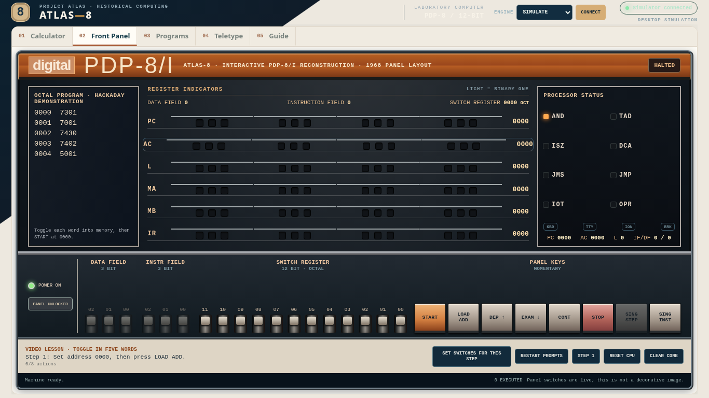
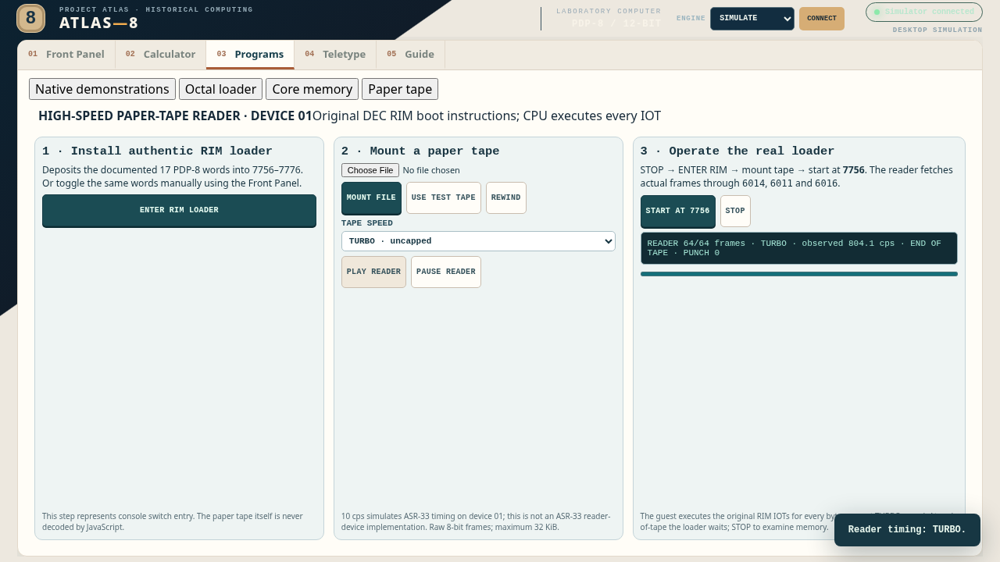
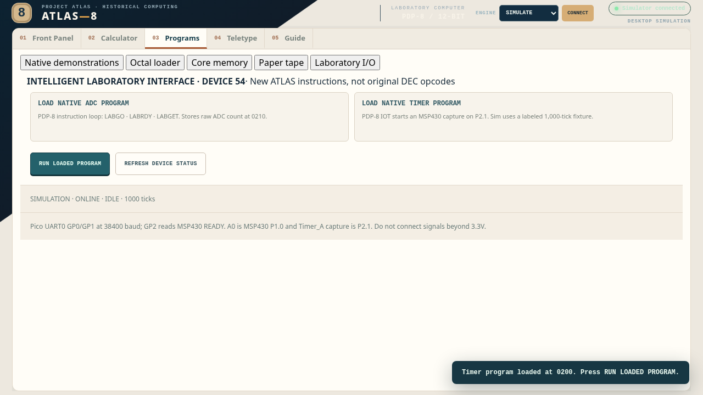

> **Canonical v0.7 reference:** [Converged instruction and instructional-state reference](docs/CONVERGED_INSTRUCTION_STATE_v0.7.md) documents the exact PDP-8/IOT semantics, RP2040/MSP430 software boundary, wire protocol, wiring, teaching progression, and verified-vs-unverified status.

> **ATLAS-8 v0.7.0 — INTELLIGENT LABORATORY I/O ENGINEERING PREVIEW:** Adds ATLAS-specific PDP-8 device-54 IOT instructions, a MicroPython RP2040 UART transport, and reference MSP430G2553 C firmware for ADC10 and Timer_A capture. The same PDP-8 program runs against a **labeled synthetic controller** on PC or a separate UART controller on Pico. **Physical boards not yet verified.** [Architecture and operator guide](docs/LAB_IO_V070.md) · [MSP430 firmware](msp430-lab/).

> **ATLAS-8 v0.6.0 - CLOCKED VIRTUAL PAPER TAPE:** The Programs -> Paper tape screen now offers **ASR-33 RATE (10 cps)**, **HIGH-SPEED (300 cps)**, and **TURBO**, plus **PLAY/PAUSE/REWIND**, effective-rate readout, tape progress and a native PDP-8 RIM loader demo. At every speed, the *emulated PDP-8* executes reader IOTs to consume each frame. [Step-by-step tape lab](docs/PAPER_TAPE_LAB.md). **ASR-33 RATE models only timing**, not the ASR-33's separate low-speed reader device. Physical Pico and FOCAL-69 remain unverified.

> **ATLAS-8 v0.5.3 Front Panel:** Launch the Windows dashboard and begin on the functional PDP-8/I front panel: switch register, LOAD ADD, DEP, EXAM, START, CONT, STOP, and SING INST. [Follow the historical five-word programming lesson](docs/FRONT_PANEL_LESSON.md). The [Pikuma PDP-8 tutorial](https://pikuma.com/blog/pdp-8-minicomputer) explains the computer architecture behind the switches. This is a functional panel reconstruction, not a cycle-accurate hardware model.




# ATLAS-8 — PDP-8 Dashboard and MicroPython Emulator

**Project Atlas | Historical Computing | v0.7.0 educational engineering preview — historically operated PDP-8/I front panel**

A working, inspectable PDP-8 educational emulator. Run it directly on a dedicated PC with a professional, five-tab Chrome dashboard, or select a Raspberry Pi Pico running the **same Python CPU core** under MicroPython. The computer being emulated is a DEC PDP-8-style 12-bit machine; the Raspberry Pi Pico is its modern physical host.

> **Compatibility warning:** 65 CPython software tests pass, and calculator/Teletype browser exercises were smoke-tested. Physical RP2040 USB serial, native FOCAL and OS/8 execution have **not yet been demonstrated**. This is a development/teaching release, not a certified complete PDP-8 implementation.

## Quick start — no hardware required

1. Clone or download this repository and open `historical-computing/atlas8-pdp8/`.
2. Install Python 3.
3. On Windows, run `START_DASHBOARD_WINDOWS.bat`. On macOS or Linux, run `python3 pc_dashboard_server.py --mode sim --open`.
4. If the browser does not open automatically, use the **exact URL printed in the server window** (normally **http://127.0.0.1:8878/**). Port 8765 is used by other Atlas tools. If 8878 is occupied, ATLAS-8 selects another available port automatically.
5. Begin in **Front Panel** and follow the video's five-word switch-programming exercise. Then use **Calculator** to explore 7+6, 7−6, or 7×6 with native PDP-8 instructions.

### Five tabs — no page scrolling

**Front Panel | Calculator | Programs (including Laboratory I/O) | Teletype | Guide**

The header switches between **SIMULATE** (CPU executes in Python on your PC) and **LIVE PICO** (the same CPU code executes in MicroPython on RP2040, connected over USB serial). No second JavaScript CPU implementation is maintained.

## What is included

| Component | Path | Purpose |
|---|---|---|
| PDP-8 CPU | [`pdp8.py`](pdp8.py) | 12-bit registers, memory addressing, IOT and OPR instruction execution |
| Browser dashboard | [`dashboard/`](dashboard/) | Responsive fixed-viewport UI: lamps, switches, trace, Teletype and calculator |
| PC host | [`pc_dashboard_server.py`](pc_dashboard_server.py) | localhost HTTP API and optional USB-serial transport |
| Shared transport | [`dashboard_bridge.py`](dashboard_bridge.py) | Identical JSON-line operations for PC/Pico |
| Pico boot | [`main_dashboard.py`](main_dashboard.py) | Copy to Pico as `main.py` for live dashboard mode |
| Native programs | [`programs.py`](programs.py) | PDP-8 machine-code examples and arithmetic |
| Loader and monitor | [`tape.py`](tape.py), [`monitor.py`](monitor.py) | RIM/BIN experiments and octal operator shell |
| Test suite | [`tests/`](tests/) | 63 CPU, historical panel, loader, reader-clock, host and deployment tests; browser smoke tests |
| Operator guide and v0.7 supplement | [`ATLAS8_Operators_and_Programmers_Manual_v0.6.0.pdf`](ATLAS8_Operators_and_Programmers_Manual_v0.6.0.pdf) and [`ATLAS8_Laboratory_Interface_v0.7.0.pdf`](ATLAS8_Laboratory_Interface_v0.7.0.pdf) | Original operator manual plus laboratory-interface installation and protocol addendum |
| Documentation | [`docs/`](docs/) | Protocol, installation, operator procedures, compatibility and release status |

## Pico LIVE mode — IMPORTANT: choose the correct `main.py`

| Your interface | Repository source | Destination on Pico | Autostarts |
|---|---|---|---|
| **Chrome LIVE PICO (default)** | **`main_dashboard.py`** | **`:main.py`** | Dashboard JSON USB bridge |
| Standalone serial monitor | `main.py` | `:main.py` | Interactive `pdp8>` prompt |

**Do not copy the repository's `main.py` for Chrome mode; do not leave the Pico without a `main.py`.** The Pico must boot the dashboard version, installed under the filename **`main.py`**. The two source files are alternatives, not simultaneously installed entry points.

**Windows: run `INSTALL_PICO_WINDOWS.bat`** to install Dashboard mode by default, with file backups and byte-for-byte readback verification. Use `INSTALL_PICO_WINDOWS.bat -Mode Monitor` for the standalone monitor. [Full deployment and recovery guide](docs/PICO_DEPLOYMENT.md).

### Manual installation (alternative)

1. Install a board-matched MicroPython UF2 on the Raspberry Pi Pico.
2. Copy the runtime modules `pdp8.py`, `programs.py`, `tape.py`, `monitor.py`, `bootstrap.py`, `lab_protocol.py`, `lab_device.py`, `lab_uart.py`, and `dashboard_bridge.py`, then copy **`main_dashboard.py` renamed as `main.py`** to the Pico filesystem. The installer automates this sequence. Do not copy `main.py` from the stand-alone monitor for dashboard operation.
3. Close Thonny/mpremote serial REPLs, attach the Pico via USB, select **LIVE PICO** in the dashboard header, enter the port (e.g. `COM7`) and connect.
4. On the PC, install `pyserial` with `python -m pip install pyserial` if it is not already installed.

See [dashboard communication protocol](docs/DASHBOARD_PROTOCOL.md), [installation](docs/INSTALL.md), [operator walkthrough](docs/OPERATOR.md), and [limitations](docs/COMPATIBILITY.md).

## Virtual paper tape (v0.6.0)



Select **Programs -> Paper tape** for an authentic PDP-8 instruction-driven RIM reader with three clocked transport modes. The browser shows tape progress, flags, nominal/observed rates and play/pause/rewind. The tape is delivered as raw frames via emulated device-01 IOTs, not host memory injection. [Paper tape lab](docs/PAPER_TAPE_LAB.md). The Pico installer includes the new required `bootstrap.py` dependency.

## Intelligent laboratory I/O (v0.7 engineering preview)



The **Programs → Laboratory I/O** sub-screen offers a native PDP-8 ADC and timer example. In PC SIMULATE mode it reads **explicitly synthetic samples** (A0 = 512 counts, timer = 1000 ticks); in LIVE PICO mode it uses the RP2040 UART and requires the MSP430 firmware and physical wiring. There is no silent synthetic fallback on Pico. The MSP430 has its own `msp430-lab/` source and must be flashed separately using TI tools. The Pico PowerShell installer has been updated to copy the three new MicroPython modules. The IOT mnemonic family (`LABGO`, `LABRDY`, etc.) is an **ATLAS extension**, not an original DEC instruction assignment. See [LAB_IO_V070.md](docs/LAB_IO_V070.md) and [wiring/firmware guide](msp430-lab/README.md).

## Tests

```bash
python -m unittest discover -s tests -v
```

The v0.7.0 engineering preview passes 65 CPython tests and a separate portable C protocol test. The original v0.5 suite had 26 checks; v0.5.1 added port-conflict checks, v0.5.2 added installation/documentation consistency checks, and v0.5.3 added PDP-8/I panel tests; v0.6.0 added reader timing/transport tests (52 total), and v0.7.0 adds thirteen lab-IOT and protocol tests. Physical Pico acceptance is still pending. The optional `tests/browser_smoke.py` requires an appropriate browser automation setup and is not included in that unittest count. No physical Pico test result is claimed.

## Architecture

```text
Chrome / JavaScript frontend (no-scroll five-tab dashboard)
                  | localhost JSON HTTP
      pc_dashboard_server.py
                  |
            target selector
        /                    \
   SIMULATE                 LIVE PICO
   Python CPU             USB serial bridge
   on PC                  MicroPython RP2040
        \                    /
              pdp8.py
  12-bit instructions, memory, TTY IOT, core state
```

MSP430 ADC10 and Timer_A I/O are now implemented **as an engineering preview**; hardware connection/target compilation remain unverified. LINC/PDP-12 and original FOCAL/OS/8 execution are future work.

## Origin and educational goal

ATLAS-8 begins with genuine front-panel machine-code entry and moves to a programmable calculator, paper-tape concepts, native PDP-8 machine instructions, I/O and Teletype. It is the PDP-8 chapter of Project Atlas's history-first Software-Defined Laboratory curriculum.

**Experience before equation. Need before technology. History before abstraction.**

[Project Atlas root](https://github.com/RandoSY/project-atlas) · [Release status](docs/RELEASE_STATUS.md) · [Operator manual](ATLAS8_Operators_and_Programmers_Manual_v0.6.0.pdf) · [v0.7 lab supplement](ATLAS8_Laboratory_Interface_v0.7.0.pdf)

## License

New original code is MIT-licensed; see [`LICENSE`](LICENSE). Historical software media and external reference projects are not bundled and retain their original rights.
