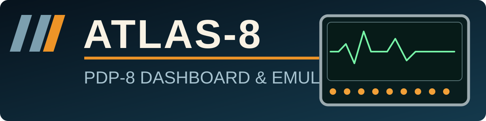

> **ATLAS-8 v0.5.3 Front Panel:** Launch the Windows dashboard and begin on the functional PDP-8/I front panel: switch register, LOAD ADD, DEP, EXAM, START, CONT, STOP, and SING INST. [Follow the historical five-word programming lesson](docs/FRONT_PANEL_LESSON.md). The [Pikuma PDP-8 tutorial](https://pikuma.com/blog/pdp-8-minicomputer) explains the computer architecture behind the switches. This is a functional panel reconstruction, not a cycle-accurate hardware model.




# ATLAS-8 — PDP-8 Dashboard and MicroPython Emulator

**Project Atlas | Historical Computing | v0.5.3 educational alpha — historically operated PDP-8/I front panel**

A working, inspectable PDP-8 educational emulator. Run it directly on a dedicated PC with a professional, five-tab Chrome dashboard, or select a Raspberry Pi Pico running the **same Python CPU core** under MicroPython. The computer being emulated is a DEC PDP-8-style 12-bit machine; the Raspberry Pi Pico is its modern physical host.

> **Compatibility warning:** 44 CPython software tests pass, and calculator/Teletype browser exercises were smoke-tested. Physical RP2040 USB serial, native FOCAL and OS/8 execution have **not yet been demonstrated**. This is a development/teaching release, not a certified complete PDP-8 implementation.

## Quick start — no hardware required

1. Clone or download this repository and open `historical-computing/atlas8-pdp8/`.
2. Install Python 3.
3. On Windows, run `START_DASHBOARD_WINDOWS.bat`. On macOS or Linux, run `python3 pc_dashboard_server.py --mode sim --open`.
4. If the browser does not open automatically, use the **exact URL printed in the server window** (normally **http://127.0.0.1:8878/**). Port 8765 is used by other Atlas tools. If 8878 is occupied, ATLAS-8 selects another available port automatically.
5. Begin in **Front Panel** and follow the video's five-word switch-programming exercise. Then use **Calculator** to explore 7+6, 7−6, or 7×6 with native PDP-8 instructions.

### Five tabs — no page scrolling

**Front Panel | Calculator | Programs | Teletype | Guide**

The header switches between **SIMULATE** (CPU executes in Python on your PC) and **LIVE PICO** (the same CPU code executes in MicroPython on RP2040, connected over USB serial). No second JavaScript CPU implementation is maintained.

## What is included

| Component | Path | Purpose |
|---|---|---|
| PDP-8 CPU | [`pdp8.py`](pdp8.py) | 12-bit registers, memory addressing, IOT and OPR instruction execution |
| Browser dashboard | [`dashboard/`](dashboard/) | Responsive fixed-viewport UI: lamps, switches, trace, Teletype and calculator |
| PC host | [`pc_dashboard_server.py`](pc_dashboard_server.py) | localhost HTTP API and optional USB-serial transport |
| Shared transport | [`dashboard_bridge.py`](dashboard_bridge.py) | Identical JSON-line operations for PC/Pico |
| Pico boot | [`main_dashboard.py`](main_dashboard.py) | Copy to Pico as `main.py` for live dashboard mode |
| Native programs | [`programs.py`](programs.py) | PDP-8 machine-code examples and arithmetic |
| Loader and monitor | [`tape.py`](tape.py), [`monitor.py`](monitor.py) | RIM/BIN experiments and octal operator shell |
| Test suite | [`tests/`](tests/) | 44 CPU, historical panel, loader, host and deployment tests; browser smoke tests |
| PDF manual | [`ATLAS8_Operators_and_Programmers_Manual_v0.5.3.pdf`](ATLAS8_Operators_and_Programmers_Manual_v0.5.3.pdf) | Operator, programmer, installation and troubleshooting guide |
| Documentation | [`docs/`](docs/) | Protocol, installation, operator procedures, compatibility and release status |

## Pico LIVE mode — IMPORTANT: choose the correct `main.py`

| Your interface | Repository source | Destination on Pico | Autostarts |
|---|---|---|---|
| **Chrome LIVE PICO (default)** | **`main_dashboard.py`** | **`:main.py`** | Dashboard JSON USB bridge |
| Standalone serial monitor | `main.py` | `:main.py` | Interactive `pdp8>` prompt |

**Do not copy the repository's `main.py` for Chrome mode; do not leave the Pico without a `main.py`.** The Pico must boot the dashboard version, installed under the filename **`main.py`**. The two source files are alternatives, not simultaneously installed entry points.

**Windows: run `INSTALL_PICO_WINDOWS.bat`** to install Dashboard mode by default, with file backups and byte-for-byte readback verification. Use `INSTALL_PICO_WINDOWS.bat -Mode Monitor` for the standalone monitor. [Full deployment and recovery guide](docs/PICO_DEPLOYMENT.md).

### Manual installation (alternative)

1. Install a board-matched MicroPython UF2 on the Raspberry Pi Pico.
2. Copy the runtime modules `pdp8.py`, `programs.py`, `tape.py`, `monitor.py`, and `dashboard_bridge.py`, then copy **`main_dashboard.py` renamed as `main.py`** to the Pico filesystem. The installer automates this sequence. Do not copy `main.py` from the stand-alone monitor for dashboard operation.
3. Close Thonny/mpremote serial REPLs, attach the Pico via USB, select **LIVE PICO** in the dashboard header, enter the port (e.g. `COM7`) and connect.
4. On the PC, install `pyserial` with `python -m pip install pyserial` if it is not already installed.

See [dashboard communication protocol](docs/DASHBOARD_PROTOCOL.md), [installation](docs/INSTALL.md), [operator walkthrough](docs/OPERATOR.md), and [limitations](docs/COMPATIBILITY.md).

## Tests

```bash
python -m unittest discover -s tests -v
```

The original v0.5 suite had 26 checks; v0.5.1 added port-conflict checks, v0.5.2 added installation/documentation consistency checks, and v0.5.3 adds PDP-8/I operator-panel execution tests (44 total). Physical Pico acceptance is still pending. The optional `tests/browser_smoke.py` requires an appropriate browser automation setup and is not included in that unittest count. No physical Pico test result is claimed.

## Architecture

```text
Chrome / JavaScript frontend (no-scroll five-tab dashboard)
                  | localhost JSON HTTP
      pc_dashboard_server.py
                  |
            target selector
        /                    \
   SIMULATE                 LIVE PICO
   Python CPU             USB serial bridge
   on PC                  MicroPython RP2040
        \                    /
              pdp8.py
  12-bit instructions, memory, TTY IOT, core state
```

Hardware MSP430 I/O, LINC/PDP-12 mode and original FOCAL/OS/8 demonstrations are **future work**.

## Origin and educational goal

ATLAS-8 begins with genuine front-panel machine-code entry and moves to a programmable calculator, paper-tape concepts, native PDP-8 machine instructions, I/O and Teletype. It is the PDP-8 chapter of Project Atlas's history-first Software-Defined Laboratory curriculum.

**Experience before equation. Need before technology. History before abstraction.**

[Project Atlas root](https://github.com/RandoSY/project-atlas) · [Release status](docs/RELEASE_STATUS.md) · [Manual PDF](ATLAS8_Operators_and_Programmers_Manual_v0.5.3.pdf)

## License

New original code is MIT-licensed; see [`LICENSE`](LICENSE). Historical software media and external reference projects are not bundled and retain their original rights.
